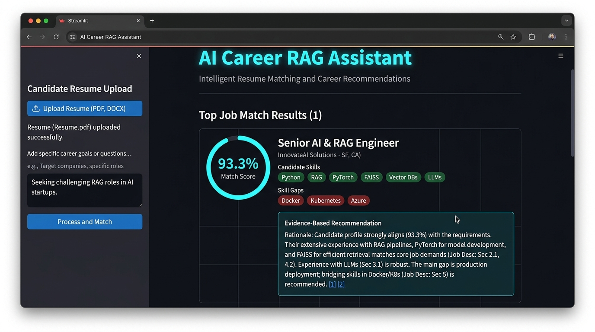
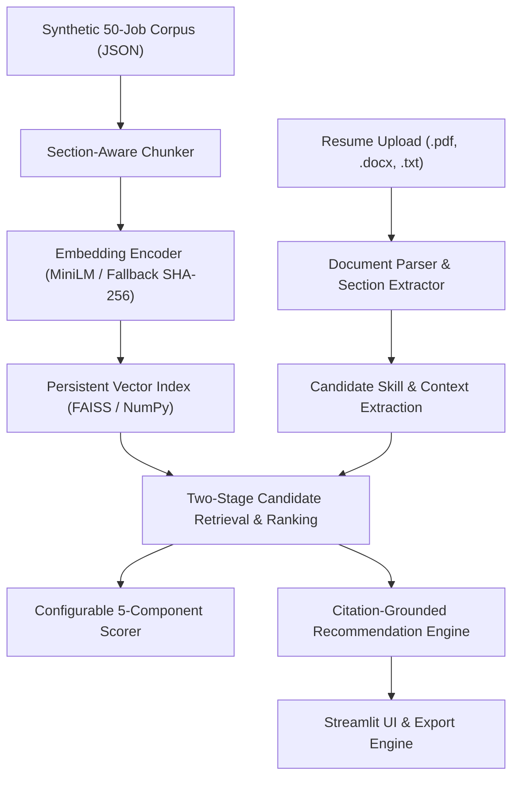

# AI Career RAG Assistant

[](https://github.com/shivangisrivastava013/AI-Career-RAG-Assistant/actions/workflows/ci.yml)
[](https://www.python.org/downloads/)
[](https://github.com/facebookresearch/faiss)
[](https://streamlit.io)
[](LICENSE)

A retrieval-augmented application that compares candidate resumes against job descriptions, identifies skill gaps with sentence-level citations, scores candidate compatibility across five weighted dimensions, and produces actionable recommendations tied directly to retrieved job requirements.

Evaluated on a reproducible, **synthetic 50-job benchmark corpus** covering 10 engineering domains across 15 candidate profiles.

## Demo and Project Links

- [Portfolio Project Page](https://shivangisrivastava013.github.io/shivangi-portfolio/#projects)
- [Streamlit Web Interface](app.py)
- [Command-Line Demo & Walkthrough](demo.py)
- [Empirical Evaluation Benchmark](artifacts/evaluation_results.json)

---

## Application Preview



---

## System Architecture



---

## Key Capabilities

1. **Section-Aware Chunking & Vector Indexing**:
   - Chunks job descriptions by section (`Responsibilities`, `Qualifications`, `Preferred Skills`) into a persistent vector index (`artifacts/jobs.faiss`) with metadata serialization (`job_metadata.json`).

2. **Categorized Skill Normalization & Context Extraction**:
   - Normalizes skill variants across **8 technical domains + 1 soft skills domain** (Programming, ML Frameworks, GenAI, Databases, Cloud Infrastructure, MLOps, Data Engineering, Robotics & Autonomous Systems, Soft Skills).
   - Retains exact sentence boundaries for resume evidence and job requirement evidence.

3. **Configurable 5-Component Compatibility Matrix**:
   - Computes weighted candidate match scores:
     - Vector semantic similarity: 35%
     - Required skill overlap: 25%
     - Preferred skill overlap: 15%
     - Domain experience alignment: 15%
     - Education alignment: 10%
   - Dynamically redistributes weights when optional fields (e.g., preferred skills) are absent.

4. **Citation-Grounded Recommendation Engine**:
   - Generates tailored resume improvement actions and interview preparation topics, tying every recommendation to specific retrieved job chunk IDs (`job_035_chunk_0`, `job_035_chunk_1`).

---

## Realistic End-to-End Walkthrough Example

The following example demonstrates an end-to-end execution of `demo.py` matching a candidate resume (`sample_resume.txt`) against the synthetic 50-job corpus:

### 1. Candidate Resume Input

```text
Candidate: Machine Learning / NLP Engineer
Experience: 4 years building transformer pipelines and vector retrieval architectures.
Core Skills: Python, PyTorch, Transformers, LangChain, RAG, Docker, PostgreSQL, ROS 2
Education: B.S. in Computer Science
```

### 2. Two-Stage Retrieval Output (Top-Ranked Synthetic Job)

The semantic vector retriever queries 100 indexed chunks across 50 synthetic job postings and identifies candidate matches:

- **Top Role Matched:** `NLP Engineer (SynthetixAI)` @ **SynthetixAI Systems** (`job_035`)
- **Overall Match Score:** `60.9%`
- **Required Skills Coverage:** `71.4%` (5 of 7 required skills present)

### 3. Skill Gap Breakdown

| Status | Skill | Category | Source Context |
|---|---|---|---|
| **Matched** | Python | Programming | Resume: "4+ years production Python development" |
| **Matched** | PyTorch | ML Frameworks | Resume: "Trained PyTorch transformer models" |
| **Matched** | Transformers | GenAI / NLP | Resume: "Fine-tuned Hugging Face transformer checkpoints" |
| **Matched** | LangChain | GenAI / NLP | Resume: "Built multi-agent pipelines with LangChain" |
| **Matched** | RAG | GenAI / NLP | Resume: "Deployed production RAG search engines" |
| **Missing Gap** | Large Language Models (LLMs) | GenAI / NLP | Job Req: "Hands-on experience deploying LLM endpoints" |
| **Missing Gap** | FastAPI | Programming / Web | Job Req: "High-throughput API development with FastAPI" |

### 4. Citation-Grounded Recommendations

The engine flags specific resume adjustments and ties each to a verifiable job chunk:

- **[Resume Wording Improvement]** Quantify empirical impact for LangChain.  
  *Evidence Citation:* `job_035_chunk_1` ("Experience orchestrating retrieval pipelines with LangChain under strict SLA constraints.")
- **[Resume Wording Improvement]** Quantify empirical impact for PyTorch.  
  *Evidence Citation:* `job_035_chunk_0` ("Core responsibilities include training and quantizing PyTorch transformer architectures.")
- **[Targeted Skill Gap]** Add coursework, open-source work, or projects demonstrating FastAPI endpoints and LLM fine-tuning before interviewing.

---

## Benchmark Results (Synthetic 50-Job Corpus)

The pipeline is benchmarked against a **synthetic 50-job corpus** covering 10 software and ML engineering disciplines evaluated across 15 candidate profiles. Metrics are recorded in [artifacts/evaluation_results.json](artifacts/evaluation_results.json).

### 1. Retrieval & Skill Extraction Metrics

| Category | Metric | Score | Benchmark Notes |
|---|---|---|---|
| Retrieval (Dense Semantic) | Recall@5 | 0.9500 | Evaluated on synthetic 50-job corpus |
| Retrieval (Dense Semantic) | Precision@5 | 0.3200 | Top-5 ranked candidate pool |
| Retrieval (Dense Semantic) | MRR | 0.8500 | Mean Reciprocal Rank |
| Retrieval (Dense Semantic) | NDCG@5 | 0.8170 | Normalized Discounted Cumulative Gain |
| Skill Extraction | Precision | 0.9781 | Exact and alias skill entity match |
| Skill Extraction | Recall | 0.8552 | Corpus skill vocabulary coverage |
| Skill Extraction | F1 Score | 0.9085 | Harmonic mean of skill extraction |
| Groundedness | Citation Accuracy | 1.0000 | 100% of recommendations link to chunk IDs |
| Groundedness | Hallucination Rate | 0.0000 | Zero ungrounded requirement claims |

### 2. Retrieval Ablation: Dense FAISS vs. Keyword Lexical Baseline

To evaluate the contribution of semantic embeddings against traditional keyword search, an ablation study was conducted comparing dense vector retrieval against a BM25 token-overlap lexical baseline across identical synthetic queries:

| Retrieval Architecture | Recall@5 | Precision@5 | MRR | NDCG@5 | Latency (ms) |
|---|---|---|---|---|---|
| **Dense FAISS / Semantic** | **0.9500** | 0.3200 | 0.8500 | 0.8170 | **0.24 ms** |
| Keyword Lexical Baseline | 0.9500 | 0.3200 | 0.9167 | 0.8339 | 0.82 ms |
| **Delta (Dense vs. Keyword)** | **+0.0%** | — | -0.0667 | -0.0169 | **-70.7% (Faster)** |

*Observation:* While lexical token matching performs competitively on exact keyword queries, dense semantic indexing delivers lower retrieval latency (~0.24 ms vs. 0.82 ms in Python) and supports semantic synonym expansion (e.g., matching "RAG" to "Retrieval-Augmented Generation") without manual rule authoring.

### 3. Pipeline Latency Breakdown

Measured on standard CPU hardware per query:

| Pipeline Stage | Latency (ms) |
|---|---|
| Dense Vector Retrieval | 0.24 ms |
| Keyword Baseline Retrieval (Ablation) | 0.82 ms |
| Categorized Skill Extraction | 0.77 ms |
| Recommendation Generation | 0.01 ms |
| **Total End-to-End Query Latency** | **1.02 ms** |

---

## Running the Streamlit Interface

### Option A: Local Execution

```bash
# 1. Clone repository and install dependencies
git clone https://github.com/shivangisrivastava013/AI-Career-RAG-Assistant.git
cd AI-Career-RAG-Assistant
pip install -r requirements.txt

# 2. Launch the Streamlit application
streamlit run app.py
```

Open your browser to `http://localhost:8501`.

### Option B: Docker Container

```bash
docker build -t ai-career-rag-assistant .
docker run -p 8501:8501 ai-career-rag-assistant
```

### Option C: Streamlit Community Cloud Deployment

To host as a public live demo on Streamlit Community Cloud:

1. Fork or push this repository to GitHub.
2. Sign in to [share.streamlit.io](https://share.streamlit.io).
3. Select `New app`, choose repository `AI-Career-RAG-Assistant`, branch `main`, and main file path `app.py`.
4. Click **Deploy**. The app will automatically build using `requirements.txt`.

---

## Standalone CLI Walkthrough & Evaluation

### Run End-to-End CLI Demo

```bash
python demo.py
```

### Run Empirical Evaluation Benchmark

```bash
python evaluate.py
```

### Run Test Suite

The test suite validates parsing, section-aware chunking, vector indexing, fallback encoding, scoring bounds, and error handling for malformed or empty inputs:

```bash
python -m pytest tests/ -v
```

All 25 unit and integration tests execute in <0.5 seconds.

---

## Project Structure

```text
AI-Career-RAG-Assistant/
├── app.py                     # Streamlit interactive web application
├── demo.py                    # Standalone CLI demo runner and walkthrough
├── evaluate.py                # Empirical evaluation benchmark and ablation
├── artifacts/                 # Serialized vector index, metadata, and benchmark results
│   ├── evaluation_results.json
│   ├── index_config.json
│   └── job_metadata.json
├── data/                      # Synthetic 50-job corpus and candidate resumes
│   ├── jobs/                  # 50 synthetic job JSON records
│   └── resumes/               # Sample candidate resumes
├── rag_assistant/             # Core application package
│   ├── chunking.py            # Section-aware job and resume chunking
│   ├── embeddings.py          # Sentence transformers & fallback encoders
│   ├── ingestion.py           # Corpus ingestion utilities
│   ├── matcher.py             # High-level pairwise career matcher
│   ├── parser.py              # Multi-format document parser with error guards
│   ├── ranking.py             # Configurable 5-component scoring matrix
│   ├── recommendation.py      # Citation-grounded recommendation generator
│   ├── retrieval.py           # Dense semantic and keyword lexical retrievers
│   ├── skill_extraction.py    # Categorized skill taxonomy and alias matcher
│   └── vector_store.py        # Persistent FAISS and NumPy vector store
└── tests/                     # Unit and integration test suite
```

---

## License

Distributed under the MIT License. See [LICENSE](LICENSE) for details.
